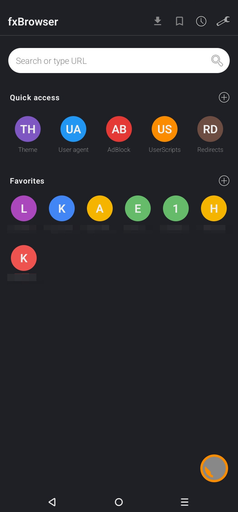
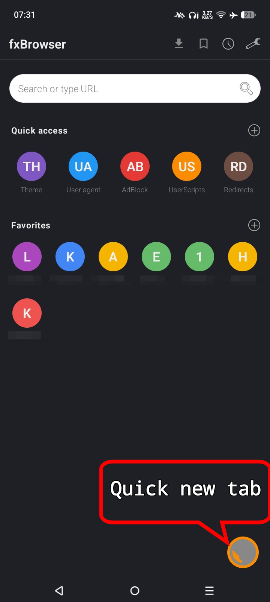
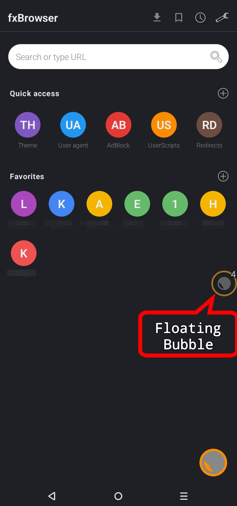
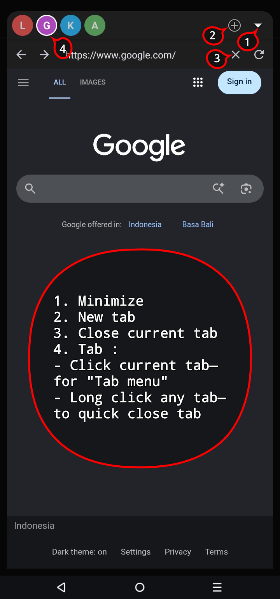
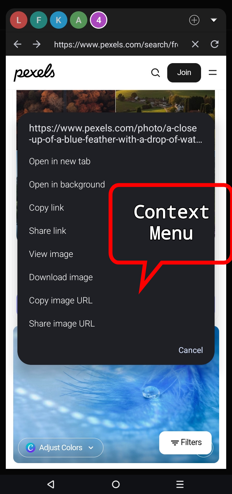
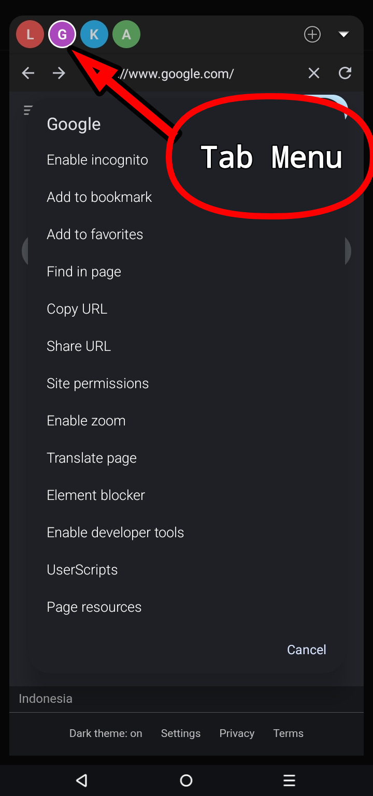
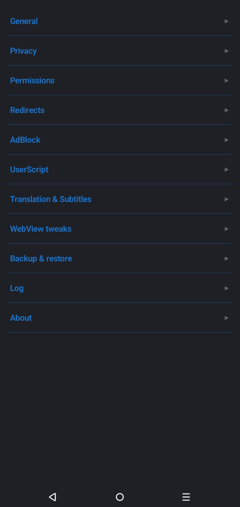
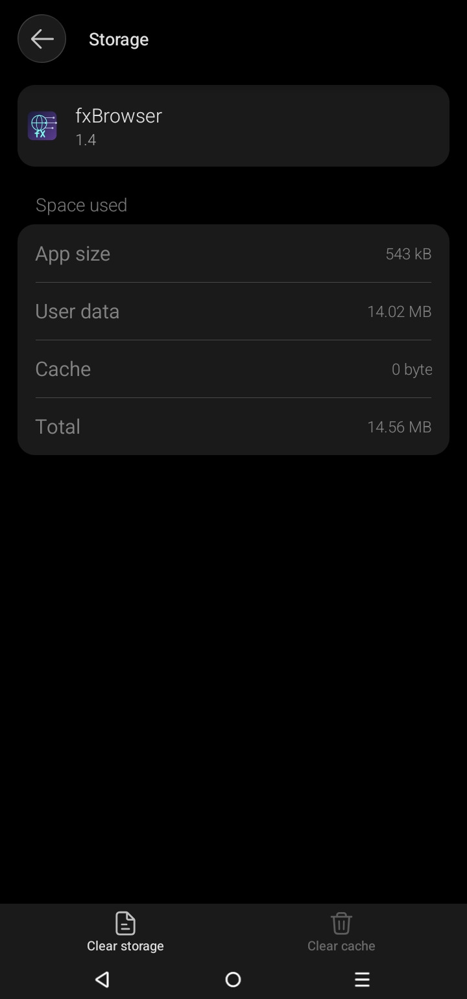

# 🌐 fxBrowser

A lightweight, privacy-focused Android browser built on the system WebView.
Pure Android SDK — no third-party libraries, no analytics, no cloud.
Everything is local.

> "Less bloat. More control. Exactly what a browser should be."

**~490KB APK size** · Android 10+ (API 29+).

> "Because less **~~code~~**❌ — **less computation** is always better ✅."

Made by a NEET. If you find this app useful, please consider supporting me — or just give me a JOB 😭️:

[ko-fi.com/f1j4r](https://ko-fi.com/f1j4r)

---

📥 **Download:** [Releases page](../../releases)
💬 **Discuss & feedback:** [Discussions](../../discussions)
🐛 **Report issues:** [Issues](../../issues)

---

## Screenshots:
 
 
 
 

---

## What is fxBrowser?

It's a browser that fits in less space than a single photo. Every feature 
runs on the Android framework that's already on your device. Nothing is 
tracked, nothing is synced, nothing leaves the phone unless you ask it to.

What you get in exchange for the small size:

- A fully functional browser with tabs, bookmarks, history, and search
- Ad blocking that handles what DNS can't reach
- A userscript engine that runs Tampermonkey-compatible scripts
- Automatic subtitle translation on streaming sites
- Full-page translation on any site
- Per-site permissions, login preservation, and external app handling
- A floating bubble that keeps tabs open across apps
- Everything backed up in a single file you control

---

## Getting started

### First launch

1. Install the app and tap the icon.
2. Grant **Display over other apps** when prompted — this is what the 
   floating bubble needs. Without it, tabs can't persist across apps.
3. Optionally grant **Notifications** — used for download completion and 
   userscript alerts. Not required.

### The home screen

- **Search bar** — type a URL or search query. Suggestions appear from 
  your bookmarks, favorites, and history.
- **Quick access row** — a grid of shortcuts (theme, ad block, user 
  agent, etc.). Configure which ones appear in Settings → General.
- **Favorites grid** — your most-visited sites.
- **Floating button (bottom right)** — opens the browser.

Top bar icons: downloads, bookmarks, history, settings.

### The bubble

The floating bubble is fxBrowser's main tab UI. Open any page and the 
bubble hovers over everything — other apps, the home screen, lock screen.

- **Tap the bubble** — opens the tab container
- **Drag the bubble** — reposition it anywhere
- **Drag to the X pill** — closes all tabs and dismisses the bubble
- **Load progress** shows as a cyan arc around the bubble

Inside the container: tabs at the top (tap to switch, long-press to 
close), the active page below, a **+** button for a new tab, and a 
minimize button to return to the bubble.

---

## Everyday browsing

### Searching

Type anything in the search bar. A URL opens directly; anything else 
becomes a search on your chosen engine. Change the engine in 
Settings → General → Search engine.

### Tabs

- **New tab:** tap **+** in the container, or the floating button on the 
  home screen
- **Switch tabs:** tap any tab in the strip
- **Close a tab:** long-press it
- **Close everything:** drag the bubble to the X pill

Tabs keep loading in the background when you switch away. Switch back 
and the page is ready.

### Bookmarks, favorites, history

All three are managed from the home screen:

- **Bookmarks** — saved pages, searchable
- **Favorites** — the home-screen grid, tap to open
- **History** — everything you've visited, newest first

Long-press any entry for options: open, edit, copy URL, or remove.

### Find in page

Tab menu → **Find in page**. Type a phrase, tap up/down arrows to jump 
between matches. Close the bar when done.

### Zoom

Two kinds of zoom:

- **Text zoom** — Settings → WebView tweaks → Text zoom. Scales text 
  size globally. Useful for reading, doesn't affect layout.
- **Pinch zoom** — Tab menu → **Enable zoom** for a specific tab. Some 
  sites disable pinch zoom by default; this overrides it for that page.

---

## Making pages load faster

### Media cache

The browser automatically caches streaming video segments (the small 
chunks that HLS and DASH players load during playback). Seeks backward, and network hiccups don't require re-downloading.

Nothing to configure. The cache clears itself when it reaches 200 MB. 
You can clear it manually from Settings → Privacy → Media cache.

### Ad blocking Tips

Two layers, both worth using:

1. **Private DNS** — set it at the Android system level for 
   device-wide blocking:
   - Settings → Network → Private DNS
   - Try `dns.adguard.com` for ads + trackers, or `dns.quad9.net` for 
     security only
   - This blocks ads for every app, not just the browser

2. **The browser's own AdBlock** — Settings → AdBlock → Enable. This 
   handles what DNS can't:
   - URL-path rules (DNS only sees hostnames)
   - Cosmetic rules (element hiding)
   - Per-site decisions

Add a filter list in Settings → AdBlock → Manage filter lists if you 
want pre-made rules. EasyList or AdGuard's list are good starting points.

### Element blocker

When an ad element slips through, use the element blocker:

1. Tab menu → **Element blocker**
2. Tap the offending element
3. Choose **Block here** (just this site) or **Block everywhere**

The rule is saved permanently. The element disappears immediately. If 
you blocked something by mistake, remove the rule in Settings → AdBlock 
→ Manage filter lists → Custom filters.

---

## Userscripts

fxBrowser runs most Tampermonkey and Greasemonkey scripts. Install 
from URL or paste.

### Installing a script

1. Find a script on Greasy Fork or similar. Copy the URL of the `.user.js` file.
2. Settings → UserScript → Manage scripts → **+** → **From URL**
3. Paste the URL, install.

### What scripts can do

The engine supports the standard GM APIs:

- `GM_setValue` / `GM_getValue` — script-specific storage
- `GM_addStyle` — inject CSS
- `GM_openInTab` — open URLs
- `GM_notification` — show notifications
- `GM_xmlhttpRequest` — make network requests
- `GM_registerMenuCommand` — add commands to the tab menu
- `GM_addValueChangeListener` — react to value changes across tabs

### About network access

Scripts that make network calls (`GM_xmlhttpRequest`) must declare 
allowed hosts in their `@connect` header. A script without `@connect` 
cannot reach any server — this is a security measure.

When you install a script, check its `@connect` list. A script with 
`@connect *` can reach anything. That's not inherently dangerous, but 
it means the script is doing whatever it wants with your session 
cookies. Only install scripts you trust.

### Managing scripts

- **Toggle on/off:** long-press a script in the list
- **Edit source:** tap a script → Edit source
- **Remove:** tap a script → Delete
- **Menu commands:** scripts can add options to the tab menu — look for 
  a "Menu commands" section when you open the tab menu on a page with 
  active scripts

---

## Watching videos with subtitles

The browser can automatically translate subtitle files (`.vtt` and 
`.srt`) as the video player loads them.

### Setup

1. Settings → Translation & Subtitles → **Translate subtitles** — on
2. Set the **Target language** to what you want to read

### Using it

Just play the video. When the player fetches subtitle files, they're 
translated before reaching the player. First load may takes several seconds 
per subtitle file; subsequent visits are instant.

### What works, what doesn't

**Works on:** sites where the video player requests subtitle files over 
the network. This covers a lot of streaming sites — anime, drama, 
international content.

**Doesn't work on:** YouTube, Netflix, Twitch, Vimeo, or any site that 
renders captions via JavaScript instead of loading subtitle files. Those 
have nothing to translate — the captions are drawn directly into the 
page.

### Tips

- **Multiple subtitle tracks:** if the site offers 9 languages, all 9 
  get translated (minus any already in your target language). This is 
  what you get if you switch tracks mid-video.
- **First play might be slow.** Subsequent plays are fast because the 
  translation is cached.
- **If nothing happens:** the site's subtitles aren't being requested 
  as separate files. Nothing to do.

---

## Translating whole pages

For any foreign-language page, tab menu → **Translate page**.

### Setup

Settings → Translation & Subtitles → Page translation → Target language. 
Independent from your subtitle language — you can read subtitles in one 
language and translate pages into another.

### How it works for you

1. Tap **Translate page** from the tab menu
2. Text appears in your target language, top to bottom, over 5–15 seconds
3. Tap the tab menu again → **Show original** to revert

### What to expect

**Good for:** articles, news sites, documentation, blogs, forums — 
anything with primarily text content.

**Partial on:** social media (Twitter/X, Reddit), single-page apps. 
Modern sites use techniques (shadow DOM, cross-origin iframes) that 
can't be reached by the translator. Some content translates, some 
doesn't.

**Doesn't touch:** form placeholders, tooltips, embedded widgets.

### Tips

- **Revert is clean.** "Show original" will reload the page with your 
  scroll position preserved. There's no half-translated state to worry 
  about.
- **Live pages translate as they change.** Scroll a news feed, new 
  articles translate as they load.
- **Occasional terms stay in the original language.** Google's free 
  translation service isn't perfect on short technical terms. This is 
  a limitation of the free service, not the browser.

---

## Managing site permissions

Camera, microphone, and location requests from sites are managed with 
three layers of control.

### The three layers

1. **Device permission** — granted to the app itself. If the browser 
   doesn't have camera access, no site can use it.
2. **Default policy** — what happens on a site without a specific 
   override. Ask, Allow, or Deny.
3. **Per-site override** — a specific decision for one site.

### First time a site asks

A prompt appears at the top of the page:

```
example.com wants camera and microphone
         [Deny] [Allow] [Remember]
```

- **Deny** — blocks this request. The site will prompt again next time.
- **Allow** — grants this request. The site will prompt again next time.
- **Remember** — saves the choice for this site. Future requests are 
  handled automatically.

### Managing permissions

**Settings → Permissions** gives you:
- A **Grant missing** button that requests all device permissions at once
- Per-permission status rows with request buttons
- **Default site policies** — Ask/Allow/Deny for any site without an override
- **Site overrides** — manage which sites have specific rules

**Tab menu → Site permissions** lets you adjust a single site on the fly.

### Tips

- **Enable once, forget forever.** If you regularly use the camera or 
  location on a site you trust, tap **Remember**. It won't ask again.
- **Geolocation works on maps.** Local search, navigation sites, 
  anything that needs your location.
- **Device permission is a hard gate.** If you deny camera at the 
  device level (Settings → Permissions), sites can't use it regardless 
  of their own policy.

---

## Preserving logins

Do you hate logging back into the same site after every "clear cookies"? 
Login preservation keeps you signed in on sites you opt in to.

> ⚠️ **Important:** If you include login sessions in a backup, that backup file grants access to those sites. Store it securely — treat it like a key.

### Enabling

1. Open a site you're logged into (or want to stay logged into)
2. Tab menu → **Site permissions**
3. Tap **Preserve login state — Off** to turn it on
4. Log in if you're not already

The state is captured when you close the tab. From that point, clearing 
cookies or wiping browser data won't log you out of that site.

### Managing

Settings → Privacy → **Site login state**:
- See which sites are preserved
- Check total size
- Remove individual sites or clear everything

### Tips

- **Turn on *before* logging in.** If you enable preservation while 
  logged out, the captured state is the logged-out state. Enable first, 
  then log in, then close the tab.
- **Logout still works.** If you log out, that's what gets captured. 
  Next visit you're logged out.
- **Backups include this — but it's off by default.** If you export 
  with "Site login state" checked, the backup file contains session 
  tokens that can log in as you. Treat that backup like a password.
- **Not all sites work.** HttpOnly cookies, short-lived sessions, and 
  some banking-style sessions won't survive the restore. Try it on a 
  site — if it works, great; if not, that site's not compatible.

---

## Apps that want to open

When a page tries to launch an external app — Telegram, WhatsApp, 
Play Store, a custom scheme — you get a prompt:

```
Open Telegram?
example.com wants to launch this app
                   [Cancel] [Open] [Always]
```

- **Cancel** — nothing happens
- **Open** — launches the app once
- **Always** — trusts this site to launch apps automatically going forward

### Managing

- **Global toggle:** Settings → Permissions → External apps → **Allow 
  app redirects**. Turn off to block all app launches.
- **Site list:** Settings → Permissions → External apps → **Allowed 
  sites**. Remove sites you no longer want auto-launching apps.

### Tips

- **Default is prompt-per-site.** First app link from any site shows 
  the prompt. If you trust the site, tap **Always**.
- **App not installed?** If the site provides a web fallback, it loads 
  automatically. Otherwise you see "App unavailable".
- **Unknown schemes still work.** If we don't recognize the app, we 
  still ask before dispatching. If the app isn't installed, you see 
  "App unavailable" after tapping Open.

---

## Downloads

Standard Android downloads, with a queue on top.

### Downloading a file

- Tap any download link on a page — the standard WebView download flow
- Or from **Page resources** (tab menu) → tap a video/audio resource → **Download**
- Or long-press a link → **Download** (from the context menu)

### What happens

A dialog appears with the filename, location, and URL:
- **Filename** — editable
- **Location** — Downloads folder (shown for reference)
- **Download** — confirms and adds to queue

Downloads run in the background via the system DownloadManager. 
Progress is shown in the Download list (home screen → downloads icon).

### 1DM integration

If you have 1DM, 1DM+, or 1DM Lite installed:
- Settings → Downloads → **Redirect downloads to 1DM**
- All downloads hand off directly to the app — no dialog, no queue entry

### Tips

- **`.m3u8` and `.mpd` files download as playlists**, not videos. These 
  are stream manifests. If you need the full video, you'll need an 
  external converter. The extension is honest — what you get is a 
  playlist file.
- **Failed downloads can retry.** Tap a failed entry → **Retry with 
  link** — paste a fresh URL if the original expired.
- **Concurrent limit:** Settings → Downloads → settings icon → max active 
  downloads (1–5).

---

## Backing up

Everything you've configured — settings, bookmarks, favorites, history, 
AdBlock lists, userscripts, preserved logins — exported to a single 
`.zip` file. Import restores on any device.

### Export

1. Settings → Backup & restore → **Export**
2. Choose categories (all are checked by default except site login state)
3. Save the `.zip` file

### Import

1. Settings → Backup & restore → **Import**
2. Select a `.zip` file from a previous export

### What gets merged, what gets overwritten

- **Settings** — overwritten (your device settings become the backup's)
- **Bookmarks, favorites, history, downloads** — merged (existing entries kept, new ones added)
- **UserScripts** — merged (same script id is skipped)
- **Site login state** — merged (existing preserved sites kept)
- **Trust lists** (redirect hosts, app redirect hosts) — merged

### Tips

- **Site login state is off by default** because the backup file 
  contains session tokens. Only enable it if you're storing the backup 
  somewhere secure.
- **Backups don't include downloaded files.** Only the download list 
  (filename + URL). The files themselves are on your device already.
- **Backups don't include subtitle or page translation caches.** These 
  are session-only, regenerated on demand.

---

## Settings tour

Every section, briefly:

**General** — homepage, search engine, user agent, suggestion sources, 
grid columns, bubble appearance, default browser.

**Privacy** — clear browsing data, cache size, media cache, cookies, 
preserved logins, clear-on-exit toggles.

**Permissions** — device permissions, defaults, per-site overrides, 
external app handling.

**Redirects** — per-site protection against cross-domain navigation.

**AdBlock** — enable toggle, filter lists, whitelist, custom rules.

**UserScript** — installed scripts, manage and edit.

**WebView tweaks** — advanced browser behavior. Everything here is 
optional. Defaults work well for most users.

**Translation & Subtitles** — subtitle translation toggle, page 
translation, target languages, cache.

**Backup & restore** — export and import.

**Log** — event viewer. Useful for bug reports. Enable to start 
capturing.

**About** — version info.

---

## Getting the most out of fxBrowser

### Recommended setup

1. **Set up Private DNS.** Device-wide ad blocking, free, one-time setup.
2. **Enable the built-in AdBlock.** Catches what DNS can't. Add a filter list if you want.
3. **Set both translation targets.** Subtitle target = the language you read subtitles in. Page target = the language you want pages translated into. Often the same, but can differ.
4. **Enable login preservation** for the 3–5 sites you visit daily and hate re-logging into.
5. **Enable subtitle translation** if you watch subtitled content.
6. **Leave everything else at default.**

### When to use the element blocker

- An ad keeps showing up despite DNS + AdBlock
- A site has an annoying element (cookie banner, sticky footer, newsletter popup) that you want permanently gone
- A page has a broken layout that you can fix by hiding the broken part

Not for: one-time interactions. If you just need to dismiss a popup once, close it normally.

### When to install a userscript

- The site has a feature you wish it had (dark mode, keyboard shortcuts, cleaner layout)
- You want to automate something repetitive
- A specific site is broken by AdBlock and you have a script to fix it

Not for: general utility. Userscripts run on specific domains — check the `@match` header before installing.

### When to preserve logins

- A site you visit multiple times per day (email, forums, streaming)
- A site you'd otherwise have to log into after every "Clear browsing data"
- Not for: banking, financial, or high-security sites — those sessions 
  are designed to expire quickly and shouldn't be preserved

---

## Limits worth knowing

Every browser has trade-offs. fxBrowser's are documented here so you 
know what to expect.

**Ad blocking** might 10–30% less effective than a full uBlock Origin 
port on ad-heavy sites. **This is intentional decision to reduce unnecessary computational cost.**
The combination of Private DNS + this AdBlock + 
the element blocker covers most real-world cases, but if you want 
uBlock-level filtering, fxBrowser isn't the right tool.

**Subtitle translation** only works on sites where subtitles arrive as 
files over the network. YouTube, Netflix, Twitch, Vimeo — none of these 
work because their captions are rendered by the player's JavaScript, 
not fetched as files.

**Page translation** is strong on articles and text content, weak on 
modern SPAs and social media. Twitter/X, Reddit, and similar sites 
will partially translate because their content lives inside shadow 
DOM that can't be reached by any DOM walker.

**Site login preservation** doesn't work for every site. Short-lived 
tokens, banking sessions, and sites that use HttpOnly cookies may not 
survive a restore. Try it on the site you care about — if it works, 
great; if not, that site's not compatible.

**No DRM support.** Widevine-protected content (Netflix, Disney+, 
Amazon Prime Video) will not play. This is a WebView limitation, not 
something the browser can fix.

**No cloud sync.** Everything is local. If you want cross-device 
sync, export a backup and manually move it.

**No extensions.** Only userscripts. Browser extensions (uBlock 
Origin, Bitwarden, etc.) don't run in this browser — use userscripts 
or accept the limitation.

---

## 🛡️ Privacy — What Doesn't Leave Your Device

- ❌ No analytics, no telemetry, no crash reports
- ❌ No account, no cloud, no remote server
- ✅ Bookmarks, history, settings — all stay local
- ✅ Backups are entirely user-controlled — choose where they go
- 🔗 **Only external network calls:** Sites you visit; filter lists you enable; Google Translate (only when you use translation); 1DM integration (if enabled)

> **The app doesn't know who you are, where you are, or what you browse. 
It can't — there's no infrastructure to tell.**

---
